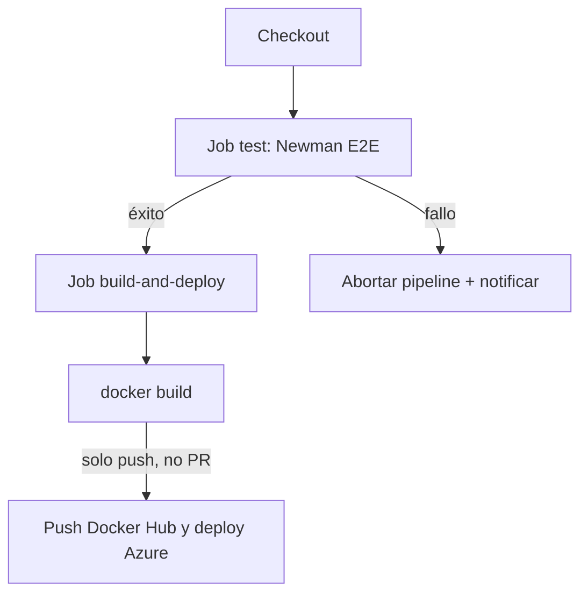

# Integración de pruebas al CI/CD y bloqueo de deploy

## Problema que se resuelve

Antes, el workflow de GitHub Actions tenía un único job `build-and-deploy`: compilaba la imagen Docker, la subía a Docker Hub y desplegaba en Azure App Service **sin ejecutar pruebas**. Un error funcional podía llegar al hosting.

El enunciado pide:

- dependencia estricta (Job Dependency) entre pruebas y construcción/despliegue
- si una prueba automatizada falla, el pipeline aborta de inmediato y notifica
- el mismo comportamiento en **pull request** y en **push**

## Workflow

Archivo: `.github/workflows/main.yml`

Se dispara en:

- `push` a `development` o `main`
- `pull_request` hacia `development` o `main`
- `workflow_dispatch` (ejecución manual)

Hay **dos jobs** en cadena:



### Job `test` — Pruebas E2E (Newman)

1. Descarga el código.
2. Instala Newman.
3. Ejecuta `tests/e2e/run-e2e.sh`, que levanta SQL Server + API y corre la colección.
4. Publica el XML de resultados como artefacto.
5. Si falló: muestra logs de Docker, escribe un error en el summary de Actions y, en un PR, deja un comentario en el pull request.
6. Baja el compose siempre (`if: always()`), para no dejar contenedores colgados.

Newman se ejecuta con `--bail`: ante el primer request o test fallido **corta la colección**. El job queda en estado `failure`.

### Job `build-and-deploy` — Docker y hosting

Declaración clave:

```yaml
build-and-deploy:
  name: Construir Docker y desplegar
  needs: test
```

`needs: test` es la **Job Dependency**. GitHub Actions no arranca este job si `test` no terminó en `success`.

Consecuencias:

| Resultado de `test` | Qué ocurre con Docker / Azure |
| --- | --- |
| success | Se construye la imagen. En push (no PR) se publica y se despliega |
| failure | El job se **omite** (`skipped`). No hay build, push ni deploy |
| cancelled | Tampoco se despliega |

En pull request también corre `test` y, si pasa, construye la imagen para validar el Dockerfile. El push a Docker Hub y el deploy a Azure siguen condicionados a `github.event_name != 'pull_request'`, para no publicar desde un PR.

## Notificación de fallo

1. **GitHub Actions**: el workflow queda en rojo. El commit y el PR muestran el check fallido. GitHub envía el mail de notificación a quienes tengan habilitadas las notificaciones del repositorio.
2. **Anotación `::error`** vía `actions/github-script`, visible en el log y en la pestaña del job.
3. **Comentario en el pull request** con el mensaje de aborto, para que el equipo lo vea sin abrir el log.

No se usa `continue-on-error`. Un fallo de Newman no se ignora.

## Cómo comprobarlo

Caso feliz: un push o PR con la colección en verde debe mostrar `test` → `build-and-deploy` en verde (el deploy real solo en push).

Caso de bloqueo: alterar a propósito una aserción (por ejemplo esperar HTTP 999 en el healthcheck), hacer push o abrir PR, y verificar que:

1. `test` falla
2. aparece la notificación / comentario
3. `build-and-deploy` queda en *Skipped*
4. Azure no recibe una imagen nueva
