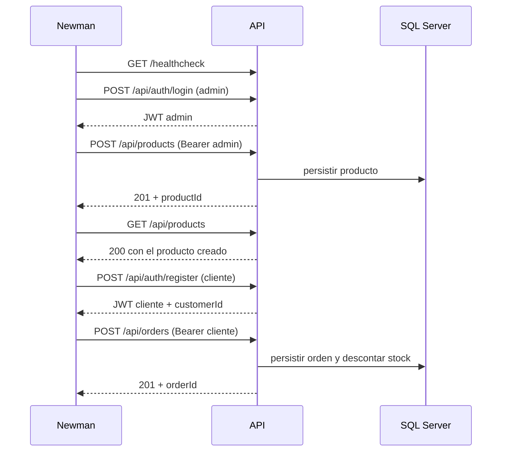

# Pruebas E2E (End-to-End)

## Objetivo

Automatizar un flujo completo de usuario sobre la API del e-commerce, sin intervención manual. El enunciado pide al menos uno de estos escenarios:

- creación de productos
- creación de orden
- listado de productos

Se implementaron **los tres**, encadenados en un único recorrido de negocio.

## Herramienta elegida

Se usó **Postman + Newman**.

| Pieza | Rol |
| --- | --- |
| Colección Postman | Define las solicitudes HTTP, el orden del flujo y las aserciones |
| Environment | Guarda `baseUrl`, credenciales de prueba y variables que se pasan de un paso al siguiente (`token`, `productId`, `customerId`) |
| Newman | Ejecuta la colección por línea de comandos, tanto en la PC como en GitHub Actions |

Newman es el runner oficial de Postman. Si una aserción falla, se invoca con `--bail` para **abortar en el primer error**.

Archivos:

- `tests/e2e/ics2026-e2e.postman_collection.json`
- `tests/e2e/ics2026-e2e.postman_environment.json`
- `tests/e2e/run-e2e.sh`
- `docker-compose.e2e.yml`

## Flujo automatizado

El escenario simula a dos actores: un **administrador** que da de alta un producto y un **cliente** que lo ve en el catálogo y genera una orden.



| Paso | Endpoint | Qué se valida |
| --- | --- | --- |
| 0 | `GET /healthcheck` | La API está en pie (HTTP 200) |
| 1 | `POST /api/auth/login` | El admin inicia sesión y se obtiene un JWT |
| 2 | `POST /api/products` | Se crea un producto con SKU único (HTTP 201) |
| 3 | `GET /api/products` | El listado público incluye el producto recién creado |
| 4 | `POST /api/auth/register` | Se registra un cliente de prueba |
| 5 | `POST /api/orders` | El cliente crea una orden de 2 unidades (HTTP 201, total 3001) |

Los datos de SKU, usuario y email se generan en cada corrida (`Date.now()`), para poder repetir la prueba sin chocar con registros anteriores.

## Entorno de ejecución

Las pruebas no usan LocalDB (no existe en Linux ni en GitHub Actions). Se levanta un entorno aislado con Docker Compose:

1. **SQL Server 2022** en un contenedor.
2. **API** construida con el mismo `Dockerfile` de producción.
3. Variables de entorno para:
   - cadena de conexión al SQL del compose
   - clave JWT
   - administrador de prueba (`SeedAdmin`)

El administrador `e2e.admin` / `Admin123!` **solo existe en el entorno E2E**. No es una cuenta de producción.

Al arrancar, la API aplica migraciones de Entity Framework (con reintentos, porque SQL Server tarda en aceptar conexiones) y luego siembra el admin de prueba.

## Cómo ejecutarlas en local

Requisitos: Docker Desktop, Node.js (para Newman) y `curl`.

Desde la raíz del repositorio:

```bash
chmod +x tests/e2e/run-e2e.sh
./tests/e2e/run-e2e.sh
```

El script:

1. levanta `docker-compose.e2e.yml`
2. espera a `http://localhost:8080/healthcheck`
3. corre Newman con `--bail`
4. deja el reporte JUnit en `tests/e2e/newman-results.xml`
5. baja los contenedores al terminar (salvo que se defina `KEEP_STACK=1`)

Para importar el flujo en la interfaz de Postman: abrir la colección y el environment de `tests/e2e/` y apuntar `baseUrl` a la API local (`http://localhost:5142` si se usa `dotnet run`, o `http://localhost:8080` con Compose).

## Criterio de éxito y de fallo

La corrida es exitosa solo si **todos** los pasos y aserciones pasan. Un HTTP inesperado, un token ausente o un producto que no aparece en el listado hacen fallar Newman. Ese fallo es el que bloquea el deploy en CI (ver `docs/ci-cd.md`).
